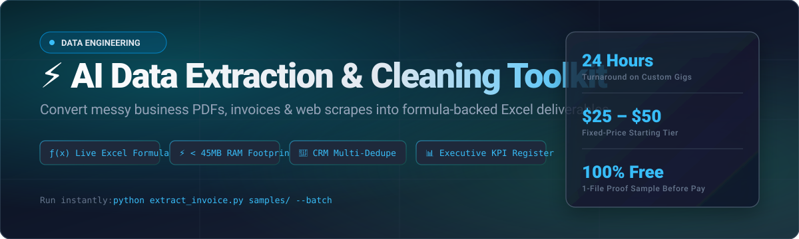
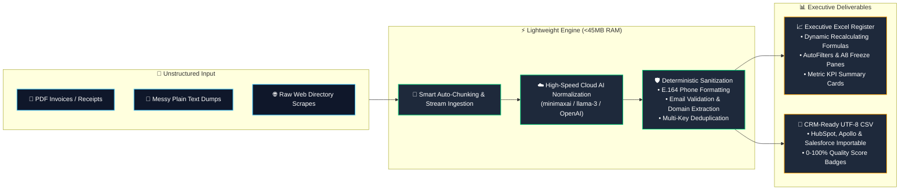

<div align="center">



# ⚡ AI Data Extraction & Cleaning Toolkit
**Production-grade, cloud-streamed data pipeline for transforming unstructured PDFs, invoices, receipts, and dirty directory scrapes into formula-backed Excel spreadsheets and CRM-ready CSVs.**

[](https://www.python.org/)
[](https://github.com/amanpratap1999/ai-data-toolkit)
[](https://github.com/amanpratap1999/ai-data-toolkit)
[](https://github.com/amanpratap1999/ai-data-toolkit)
[](final_ai_data_toolkit_demo.mp4)
[](mailto:amanpratapsingh1999@gmail.com)
[](LICENSE)

<p align="center">
  <a href="#-why-clients-hire-this-pipeline">Why Clients Hire</a> •
  <a href="#-end-to-end-architecture">Architecture</a> •
  <a href="#-key-features">Key Features</a> •
  <a href="#-visual-before--after-showcase">Before &amp; After</a> •
  <a href="#-quickstart-in-60-seconds">60s Quickstart</a> •
  <a href="#-commercial-services--hire-me">Commercial Services</a> •
  <a href="final_ai_data_toolkit_demo.mp4"><b>▶️ Watch Video (90s)</b></a>
</p>

---

</div>

> [!TIP]
> **🎥 Watch the Full 90-Second 1080p Video Walkthrough:**
> [Click here to open `final_ai_data_toolkit_demo.mp4`](final_ai_data_toolkit_demo.mp4) — includes the cinematic AI intro hook, live batch extraction terminal logs, dynamic formula Excel spreadsheet inspection, and commercial pricing tiers.

## 💼 Why Clients Hire This Pipeline

Operations teams, real estate brokerages, e-commerce brands, and sales agencies lose **15–20 hours every week** manually transcribing PDFs or wrangling broken web scrapes. 

Most generic scripts fall short: they hardcode static numbers into Excel, time out on bulk documents, or demand expensive 16GB+ GPU servers.

This toolkit solves that with a **commercial-grade, cloud-accelerated engine**:
- **📊 Real Dynamic Excel Formulas:** We write native formulas (`=C13*D13`, `=SUM(...)`, `=E18+E19+E20`) — accountants and managers can edit a price and have totals update automatically.
- **⚡ 8GB RAM Safe (<45MB Footprint):** Streams document text to cloud inference endpoints (NVIDIA NIM / OpenAI-compatible); runs flawlessly on any standard laptop or free-tier VPS without local GPU dependencies.
- **🎯 B2B Data Enrichment:** Automatically formats phones to E.164 (`+1 (215) 555-7821`), sanitizes emails, infers missing website URLs from corporate domains, and scores leads from 0–100%.
- **🛡️ Enterprise Reliability:** Automatic exponential backoff handles API rate limits and network latency with zero lost records.

---

## 🔄 End-to-End Architecture



---

## 🌟 Key Features

### 1. Invoice & Financial Extractor (`extract_invoice.py`)
Turn scattered text, scanned bills, and PDFs into executive accounting spreadsheets.
* **Dynamic Recalculations:** Writes native `=SUM(...)` and line-item formulas. No static text amounts.
* **Status Pills & Corporate Styling:** Visual badges (`PAYMENT DUE`, `PENDING REVIEW`) with navy executive styling and zebra striping.
* **Executive Master Register (`--batch`):** Processes an entire folder of invoices into a consolidated master workbook with top-level KPI summary cards (`Total Spend`, `Average Invoice Value`) plus dedicated sheet tabs per invoice.
* **Native PDF Parsing:** Directly ingests `.pdf` and `.txt` files without third-party converters.

### 2. Scraped Directory & Lead Cleaner (`clean_scraped_data.py`)
Transform messy web scraped dumps into clean, verified sales directories.
* **Smart Auto-Chunking:** Automatically recognizes listing boundaries (`---`, headers, line blocks) to eliminate timeouts on bulk dumps.
* **Multi-Format Ingestion:** Ingests raw `.txt`, `.csv`, and `.json` scrape dumps seamlessly.
* **Intelligent Multi-Key Deduplication:** Detects overlapping listings across Company Name, Primary Email, and Phone digits, keeping the highest quality record.
* **Completeness & Quality Scoring:** Computes a 0–100% CRM health score and tags records as `HIGH QUALITY`, `MEDIUM`, or `INCOMPLETE`.
* **Enterprise Spreadsheet Polish:** Freeze Panes pinned at `A8` and active AutoFilters on all columns (`A7:J10`).
* **Dual Export:** Outputs both an executive Excel workbook (`.xlsx`) with clickable `mailto:` / web hyperlinks and a UTF-8 BOM CSV ready for CRM import.

---

## 🥊 Feature Matrix: Naive Scripts vs. Enterprise Toolkit

| Capability | Naive Freelance Scripts | ⚡ AI Data Extraction Toolkit |
| :--- | :---: | :---: |
| **Excel Calculations** | Hardcoded static numbers | **Live Dynamic Formulas (`=C*D`, `=SUM`)** |
| **Batch Processing** | 1 file at a time | **Master Register with Executive KPI Cards** |
| **Hardware Requirement** | 16GB RAM / Local GPU models | **<45MB RAM (Runs on standard 8GB laptops)** |
| **Deduplication** | None (Duplicate rows slip into CRM) | **Multi-Key Auto-Dedupe (Company, Email, Phone)** |
| **B2B Enrichment** | Raw unstructured strings | **E.164 Phones + Auto-inferred Web Domains** |
| **Excel Usability** | Plain raw cells | **Freeze Panes (`A8`) & Column AutoFilters** |
| **Network Resilience** | Crashes on 429 rate limits | **Auto Exponential Backoff Retry Engine** |
| **CRM Compatibility** | Manual copy-pasting | **Direct UTF-8 BOM CSV Export (HubSpot/Apollo)** |

---

## 📊 Visual Before & After Showcase

<table width="100%">
<tr>
<th width="50%">🔴 Raw Unstructured Input</th>
<th width="50%">🟢 Clean Structured Deliverable</th>
</tr>
<tr>
<td>

```text
========================================
GLOBAL PACIFIC LOGISTICS & FREIGHT
INVOICE: INV-2026-8819B
ISSUED: 14-Nov-2026 | DUE: 14-Dec-2026

BILLED TO: Apex Commercial Retailers Inc.

LINE ITEMS:
1. Ocean Freight Container 40ft (Shanghai -> LA)
   Qty: 2 | Unit Price: 2,150.00 | Total: 4,300.00
2. Customs Clearance & Harbor Drayage Fee
   Qty: 1 | Unit Price: 420.00   | Total: 420.00
3. Chassis Inspection & Terminal Handling
   Qty: 1 | Unit Price: 185.00   | Total: 185.00

Subtotal: $4,905.00
Fuel Surcharge (4.5%): $220.73
California State Logistics Tax (1.5%): $73.58
Discount Applied: -$69.17
TOTAL BALANCE DUE: $5,130.14
========================================
```

</td>
<td>

```text
📊 Excel Output (With Live Dynamic Formulas):
------------------------------------------------------------
• Row 13 Total: =C13*D13            -> $4,300.00
• Row 14 Total: =C14*D14            ->   $420.00
• Row 15 Total: =C15*D15            ->   $185.00
------------------------------------------------------------
• Subtotal:     =SUM(E13:E15)       -> $4,905.00
• Tax/Surcharge:                    ->   $294.31
• Early Credit:                     ->   -$69.17
• BALANCE DUE:  =E18+E19+E20        -> $5,130.14 [PAYMENT DUE]
------------------------------------------------------------
✨ Navy Header Styling | Zebra Striping | Auto-Fitted Widths
```

</td>
</tr>
</table>

> [!TIP]
> **Inspect the Pre-Generated Deliverables:** You can open and inspect the actual Excel files generated by this pipeline directly from the [`portfolio_showcase/`](portfolio_showcase/) folder:
> - [`Master_Invoice_Register.xlsx`](portfolio_showcase/Master_Invoice_Register.xlsx) — Multi-invoice consolidated register with KPI cards.
> - [`clean_leads_raw_business_leads_3.xlsx`](portfolio_showcase/clean_leads_raw_business_leads_3.xlsx) — Clean B2B directory with freeze panes & AutoFilters.
> - Detailed transformation walkthrough: **[docs/BEFORE_AFTER.md](docs/BEFORE_AFTER.md)**.

---

## 🚀 Quickstart in 60 Seconds

### 1. Clone & Install Dependencies
```bash
git clone https://github.com/amanpratap1999/ai-data-toolkit.git
cd ai-data-toolkit
pip install -r requirements.txt
```
*Memory footprint stays under 45MB RAM — no PyTorch, no CUDA, no heavy local weights.*

### 2. Configure API Credentials
Copy `.env.example` to `.env` and set your cloud inference credentials (e.g. free NVIDIA NIM or OpenAI):
```bash
cp .env.example .env
```
Edit `.env`:
```ini
NVIDIA_API_KEY=nvapi-your-key-here
NVIDIA_BASE_URL=https://integrate.api.nvidia.com/v1
MODEL_NAME=minimaxai/minimax-m3.1-flash
```

### 3. Run the CLI Demos

<details open>
<summary><b>1. Extract a Single Invoice into Dynamic Formula Excel</b></summary>

```bash
python extract_invoice.py samples/raw_invoice_1.txt
```
*Generates `output/invoice_INV-2026-8819B.xlsx` with navy header styling, currency formatting, and live calculation formulas.*
</details>

<details open>
<summary><b>2. Batch Process Multiple Invoices into a Master Register</b></summary>

```bash
python extract_invoice.py samples/ --batch
```
*Generates `output/Master_Invoice_Register.xlsx` featuring executive KPI cards (`Total Invoices`, `Cumulative Spend Balance`, `Average Spend`) plus dedicated breakdown tabs per invoice.*
</details>

<details open>
<summary><b>3. Clean & Enrich Dirty Web Scrapes into Excel & CRM CSV</b></summary>

```bash
python clean_scraped_data.py samples/raw_business_leads_3.txt
```
*Generates `output/clean_leads_raw_business_leads_3.xlsx` (with `A8` freeze panes and AutoFilters) and `output/clean_leads_raw_business_leads_3.csv` ready for HubSpot or Apollo upload.*
</details>

---

## 📁 Repository Structure

```
ai-data-toolkit/
├── assets/
│   └── hero-banner.svg         # Modern vector visual hero header
├── core/
│   ├── client.py               # Cloud inference client with exponential backoff retry
│   ├── schema.py               # Pydantic invoice models & financial line item validation
│   ├── exporter.py             # OpenPyXL engine with live dynamic formulas & batch KPI register
│   ├── lead_schema.py          # Pydantic lead models with auto phone & domain enrichment
│   └── lead_exporter.py        # Excel lead directory with AutoFilter, freeze panes & CRM CSV
├── samples/
│   ├── raw_invoice_1.txt       # B2B Freight logistics invoice ($5,130.14)
│   ├── raw_invoice_2.txt       # Tech cybersecurity invoice ($13,725.00)
│   ├── raw_receipt_2.txt       # Restaurant POS receipt
│   └── raw_business_leads_3.txt # Dirty directory scrape with 3 business listings
├── portfolio_showcase/         # Pre-generated, verifiable deliverables
│   ├── invoice_INV-2026-8819B.xlsx
│   ├── Master_Invoice_Register.xlsx
│   ├── clean_leads_raw_business_leads_3.xlsx
│   └── clean_leads_raw_business_leads_3.csv
├── docs/
│   └── BEFORE_AFTER.md         # Detailed visual transformation guide
├── requirements.txt            # Minimal dependencies (<45MB RAM footprint)
├── .env.example                # Configuration template
├── extract_invoice.py          # Invoice extraction CLI
└── clean_scraped_data.py       # Scraped data & lead cleaning CLI
```

---

## 💼 Commercial Services & Hire Me

Need custom extraction or scraping automation for your business? I build and maintain bespoke Python data pipelines with **guaranteed 24-hour turnaround**.

### 📦 Service Packages

| Package | Investment | Deliverables | Turnaround |
| :--- | :---: | :--- | :---: |
| **Starter Script** | **$25** | • Custom parser script for 1 document type or directory scrape<br>• Styled Excel output with live calculation formulas<br>• Full Python source code & documentation | **24 Hours** |
| **Pipeline Pro** | **$50** | • Batch ingestion runner with Master KPI Register<br>• Automated phone/email sanitization & domain enrichment<br>• CRM-ready CSV export (HubSpot, Apollo, Salesforce)<br>• Automated multi-key deduplication | **24–48 Hours** |
| **Monthly Retainer** | **$100 / mo** | • Ongoing maintenance & schema updates for evolving data formats<br>• Weekly or on-demand batch runs executed for your team<br>• Priority bug fixes & Slack/Email support | **Ongoing** |

### 🛡️ The 1-File Risk-Free Guarantee
> **Test before you pay:** Send me **1 sample invoice, PDF, or messy scrape snippet**. I will extract it and send back the structured Excel sheet for your review. If the output doesn't match your exact specifications, you owe nothing.

### 📬 Get In Touch
* **Email:** [amanpratapsingh1999@gmail.com](mailto:amanpratapsingh1999@gmail.com)
* **GitHub:** [@amanpratap1999](https://github.com/amanpratap1999)
* **Payment Terms:** Invoiced securely via **PayPal** upon milestone approval.

---

<div align="center">
  <sub>Built with ❤️ by Prakhar Singh • Released under the MIT License</sub>
</div>
